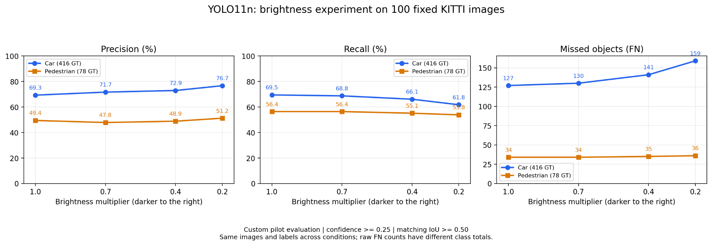

# RUS — Camera Perception Robustness & Automated V&V

> **연구주제 변경 계획 (2026-10-22 ~ 2026-12-31)**  
> 공식 변경·승인 절차는 별도 확인 필요. 이 저장소에는 9월 LiDAR 선행 실험 코드도 보존합니다.

## 연구 주제

**환경 및 영상 열화 조건에서 Camera 기반 자율주행 인지 소프트웨어의 강건성 한계 분석 및 자동 검증 연구**

*Automated Robustness Validation and Failure Boundary Analysis of Camera-based Autonomous Driving Perception under Image Degradation*

## 연구 목표

단순히 영상 열화가 커질수록 인식 성능이 감소하는지 비교하는 데서 끝내지 않고, **요구 성능을 만족하지 못하기 시작하는 조건(Failure Boundary)**을 탐색하고 **반복 가능한 자동 검증·회귀 테스트(Regression Testing)**를 구축합니다.

1. 공개 자율주행 Camera 데이터셋 및 사전학습 객체 검출기(YOLO 계열)로 정상 영상 성능(Baseline) 측정
2. 저조도(Brightness 감소), Blur, Noise, Fog의 통제된 영상 열화 조건 생성
3. Precision, Recall, mAP, False Negative, 추론 시간 등 정량 평가
4. 요구 성능의 PASS/FAIL 전환 구간, 복합 열화 조건의 Robustness Map 분석
5. 테스트 자동 실행, 기존 결과 대비 Regression 검출, 소규모 GitHub Actions 기반 CI/CT 시도

**주의:** 데이터셋·모델 버전 및 PASS/FAIL Threshold는 예비 평가 이후 본 실험 전에 확정합니다. 영상 인지 성능 검증은 실차 주행 안전성 보증과 다릅니다.

## 연구 흐름 (계획)

```text
Labeled Camera Dataset
       ↓
Image Degradation Generator
(Brightness / Blur / Noise / Fog)
       ↓
Pretrained Object Detector
       ↓
GT-based Evaluation
(Precision / Recall / mAP / FN / Latency)
       ↓
Requirement Check → PASS / FAIL
       ↓
Failure Boundary / Robustness Map
       ↓
Automated Regression Test
       ↓
Lightweight CI / CT
```

## 진행 상태 (2026-11-03 업데이트)

| 항목 | 상태 |
|---|---|
| KITTI·YOLO11n / 고정 100장 | 구축·원본 평가 완료; 자동차 GT 416, 보행자 GT 78 |
| 원본 + 밝기·Blur·Noise 각 3단계 | 기존 10조건 평가 완료 |
| Noise 30 실패 사례 분석 | 자동차 새로 놓침 66·새로 찾음 13, 보행자 18·0 |
| JSON 설정 기반 통합 실행 | 100장 실행 완료; 개별 실행과 집계 20/20행 일치 |
| 잠정 PASS/FAIL | draft_v0.1: 두 클래스 모두 원본 재현율 90% 이상 유지 |
| 기존 9개 열화 조건 판정 | PASS 6 / FAIL 3; 원본은 REFERENCE |
| 추가 Noise 25·22 | 모두 FAIL; 22는 보행자 유지율 88.64%로 미달 |
| 판정 코드의 --summary 옵션 | 추가 결과 지정·저장 및 기존 기본 판정 유지 확인 |
| 로컬 백업 | 4489.1 MB 압축 및 gzip 무결성 검사 완료 |
| 최종 기준·독립 본 평가 | 미완료; 파일럿 검토 후 확정 |
| Fog·복합 열화·mAP·전체 성능 회귀 자동화·CI | 미완료 |

현재 수치는 **conf=0.25, 정답 연결 IoU=0.5인 사용자 정의 파일럿 평가**다. 재현율 유지율과 재현율 자체를 구분한다. 예를 들어 Noise 22 보행자의 재현율은 50.00%, 원본 대비 유지율은 88.64%이다. 90% 유지 기준은 잠정 기준이며 정확한 최종 실패 경계나 실차 안전성을 확정한 결과가 아니다.

### 최신 기록과 결과

- [10조건 통합 실행·잠정 판정·추가 Noise 탐색 상세 기록](docs/research_logs/2026-11-03_validation_and_noise_boundary.md)
- [기존 10조건 평가 CSV](docs/experiments/2026-11-03_validation/validation_pilot_100_summary.csv)
- [Noise 22 평가 CSV](docs/experiments/2026-11-03_validation/noise_22_summary.csv)
- [Noise 25 평가 CSV](docs/experiments/2026-11-03_validation/noise_25_summary.csv)
- [잠정 판정 설정](configs/validation_criteria.json)
- [보고서 내용·사진 구성안](docs/report_outline_2026_11_05.md)
- [초기 밝기 파일럿 상세 기록](docs/research_logs/2026-11-01_kitti_brightness_pilot.md)
- [환경과 명령어](docs/environment.md)
- [현재 일정과 실제 완료 상태](docs/roadmap_2026_10_31.md)

실행 도구는 연구실 PC의 `scripts/run_validation.py`(열화 생성·추론·평가)와 `scripts/judge_validation.py`(저장 결과의 요구조건 판정)다. 이번 원격 갱신은 사용자 제공 터미널 수치로 재구성한 CSV·문서·잠정 기준 설정을 반영했다. 연구실 PC 최신 실제 소스·고정 100장 manifest·전체 상세 JSON·새 결과 이미지·패키지 목록·4.4GB 백업 자체를 업로드한 것은 아니다. 현재 저장소만으로 전체 실험을 재실행할 수 있는 단계는 아니다.




## 일정 / 문서

- [연구계획 변경안](docs/research_plan_2026_10_22.md)
- [현재 수정 일정](docs/roadmap_2026_10_31.md)
- [10월 22일 초기 로드맵 (보존)](docs/roadmap_2026_10_22.md)
- [Test Case / Metric 설계](docs/test_plan.md)
- [연구 변경 이력](docs/CHANGELOG.md)
- [Notion 연구일지·실험 기록](https://app.notion.com/p/f81225ee6937832b87c9019d33780aa7)

## 이전 LiDAR 연구 보존

2026년 9월에는 ROS2 Humble과 공개 VLP-16 데이터에서 PointCloud2 / rosbag을 활용하고 **Point Dropout 10%, 30%, 50%, 70%** 실험을 수행했습니다. 해당 내용은 신규 Camera 연구의 *선행 연구 경험*으로 보존합니다.

- [기존 ROS2 LiDAR Dropout 코드](src/lidar_dropout/)
- [변경 전 README 백업](docs/archive/README_lidar_original_2026-09.md)

## 졸업프로젝트와의 구분

- **졸업프로젝트:** CARLA + Autoware + V2V Cooperative Driving의 시스템 수준 검증
- **RUS:** Camera 객체 검출 SW의 열화 조건별 한계 및 자동 회귀검증

이번 RUS에는 CARLA 기반 전체 주행, V2V, Planning/Control, UGV 실환경 주행, HIL 구현은 포함하지 않습니다.

## 다음 학기 연구 방향 (제안)

2027년 1학기에 실제 UGV Camera 데이터를 수집하고, 이번 학기 검증 프레임워크를 재사용하여 인위적 영상 열화와 실제 저조도·역광·진동 환경의 **Synthetic-to-Real 강건성 차이**를 분석할 계획입니다.
