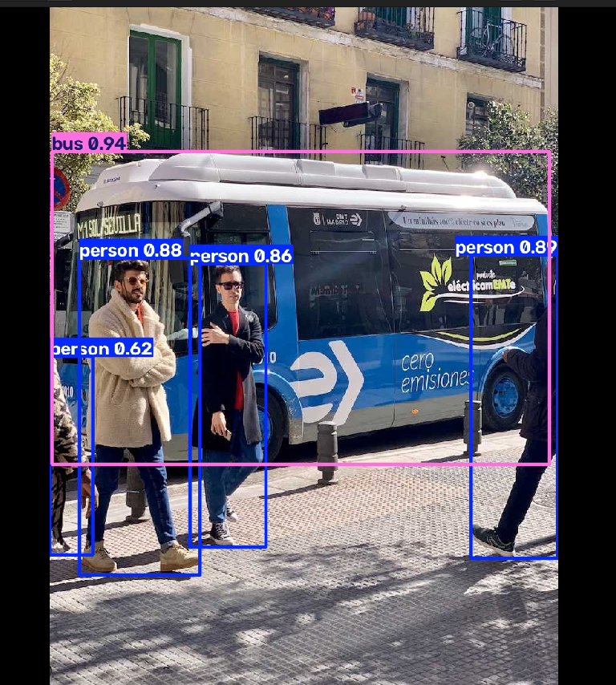

# 2026-10-30 연구 기록: GPU 환경 구축 및 YOLO 첫 검출

기록 갱신: 2026-10-31 (KST)

## 목적

Camera 객체 검출 연구를 위한 독립 Python 환경을 구성하고, 사전학습 YOLO11n이 연구실 GPU에서 추론과 결과 저장을 수행하는지 확인한다.

## 완료한 작업

1. `~/camera_perception_validation/.venv` 가상환경 생성 및 활성화.
2. PyTorch 및 Ultralytics 설치.
3. RTX 3060 인식과 GPU 행렬 연산 확인.
4. 공식 예제 `bus.jpg`에 YOLO11n 객체 검출 실행.
5. 결과 이미지 저장 및 시각적 확인.

환경과 재실행 명령은 [개발 환경 문서](../environment.md)에 정리했다.

## 입력과 설정

| 항목 | 값 |
|---|---|
| 이미지 | 공식 예제 [bus.jpg](https://ultralytics.com/images/bus.jpg), 1장 |
| 모델 | `yolo11n.pt` |
| device | 0 (RTX 3060) |
| imgsz | 640 |
| confidence threshold | 0.25 |
| 로그상 입력 shape | (1, 3, 640, 480) |
| 정답 라벨 대조 | 미수행 |
| 평가 데이터셋 / subset | 아직 미구성 |

## 관찰된 실행 결과

| 항목 | 결과 |
|---|---|
| GPU 사용 가능 | True |
| GPU 행렬 곱 검증 값 | 100.0 |
| 검출 개수 | 사람 4명, 버스 1대 |
| 전처리 시간 | 20.7 ms |
| 추론 시간 | 6.7 ms |
| 후처리 시간 | 10.1 ms |

위 시간은 한 장을 실행했을 때 출력된 관찰값이며, 반복 측정 평균이나 전체 처리량 벤치마크가 아니다.
검출 개수와 박스의 confidence는 정답 기반 정확도가 아니다. Precision·Recall·mAP·FN은 아직 계산하지 않았다.

## 사용자 제공 결과 캡처

사용자가 연구실 PC 실행 후 제공한 결과 화면이다. 새로 생성하거나 별도로 재실행한 결과가 아니다.
입력 이미지 출처: Ultralytics 공식 예제. 왼쪽과 오른쪽 가장자리의 일부만 보이는 사람도 검출 박스에 포함된다.

## 문제와 해결

- 문제: 결과를 `results/first_prediction/bus.jpg`에서 열려 하자 파일 없음 오류 발생.
- 원인: 실제 저장 경로에는 `runs/detect/`가 추가되어 있었다.
- 해결: 실행 로그의 `Results saved to` 경로를 사용해 이미지를 열었다.
- 실제 경로: `~/camera_perception_validation/runs/detect/results/first_prediction/bus.jpg`.

## 다음 단계

- [ ] KITTI 이미지와 정답 라벨 확보.
- [ ] 먼저 10장으로 정답 박스·예측 박스 및 클래스 대응 확인.
- [ ] 고정된 50~100장으로 정상 영상 평가.
- [ ] 밝기 감소 3단계와 원본의 성능 비교.
- [ ] 실제 PC의 전체 패키지 목록 `requirements_initial.txt` 확보.

이 기록은 **환경 구축과 첫 추론의 정상 동작 확인 완료**를 의미한다. 데이터셋 Baseline 평가, 열화 실험, Failure Boundary, 자동 회귀검증의 완료를 의미하지 않는다.
