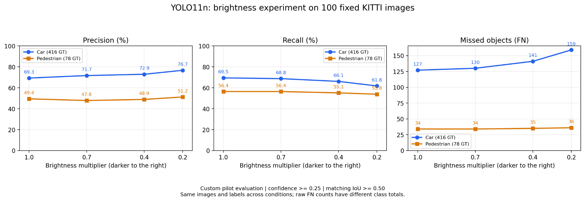

# KITTI 준비와 밝기 강건성 예비 실험

기록 기준: 2026-11-01 (KST). 근거: 사용자 제공 연구실 PC 터미널 출력, CSV 본문, 원본 그래프 및 실패 비교 이미지. 연구실 PC에서 수행한 결과이며 저장소 업데이트 과정에서 모델을 재실행하지 않았다.

## 진행 과정

| 실제 수행일 | 완료 내용 |
|---|---|
| 2026-10-30 | Python 가상환경, PyTorch/Ultralytics, RTX 3060 계산 확인. YOLO11n 예제에서 사람 4명·버스 1대 검출 |
| 2026-10-31 | KITTI 이미지·정답 ZIP 확보. training 이미지 7,481장과 라벨 7,481개 압축 해제·개수 확인 |
| 2026-10-31 | 000000 이미지의 GT 시각화, YOLO 예측 비교. 사람 신뢰도 0.9067, IoU 0.8850 |
| 2026-10-31 | 첫 10장(000000–000009)의 자동차·보행자 시각화 및 정량 예비 평가. 제외 사유 점검 |
| 2026-11-01 | 10장 밝기 1.0/0.7/0.4/0.2 평가와 실패 비교 |
| 2026-11-01 | 첫 10장을 제외하고 seed 42로 고정한 100장에 같은 4조건 평가: 총 400회 이미지 예측 |
| 2026-11-01 | 결과표·그래프·새로 놓친 물체 비교 사진 생성 및 검토 |

100장은 확대 예비 실험용이며 최종 독립 검증 세트가 아니다. KITTI의 training 부분을 평가 데이터로 활용했으며 모델을 새로 학습시키지 않았다.

## 실행 환경과 고정 조건

- 연구실 프로젝트: `~/camera_perception_validation`
- Python 3.10.12 / PyTorch 2.7.1+cu128 / Ultralytics 8.4.193
- RTX 3060 12 GB / CUDA device 0
- 모델: 사전학습 YOLO11n (`yolo11n.pt`)
- `imgsz=640, conf=0.25, iou=0.7, rect=True`
- 여기서 predict의 `iou=0.7`은 NMS 설정이다. 아래 정답 연결 IoU 0.5와 역할이 다르다.
- 밝기 변환: 원본 픽셀에 배율을 곱한 뒤 0–255 범위 제한, uint8 변환(소수점 버림). 매 조건을 원본에서 생성하여 누적 변환 방지.
- PNG 입력, 같은 이미지 목록·정답·모델·설정 사용. 기하학적 변화가 없어 정답 좌표 유지.
- 100장 정답: Car 416개, Pedestrian 78개.

## 사용자 정의 예비 평가 규칙

공식 KITTI 평가 또는 AP/mAP가 아니다. 현재는 confidence 0.25에서의 TP/FP/FN, Precision/Recall을 계산한다.

1. KITTI `Car` ↔ YOLO `car`, `Pedestrian` ↔ `person`으로 대응한다.
2. 신뢰도 높은 예측부터 아직 연결되지 않은 같은 종류의 GT 중 IoU가 가장 높은 것을 연결한다. IoU ≥ 0.5이면 TP. GT와 예측은 일대일이다.
3. 미연결 GT는 FN. 사용된 GT와만 기준 이상 겹치는 중복 예측은 FP로 처리한다.
4. 나머지 자동차 예측은 `Van`, 사람 예측은 `Person_sitting`과 IoU ≥ 0.5이면 제외한다. 제외 물체 하나당 예측 하나만 연결한다.
5. 남은 예측 면적의 50%를 초과하는 부분이 하나의 `DontCare` 영역에 덮이면 제외한다. 분모는 예측 면적이며 IoU와 다르다.
6. 그 외 미연결 예측은 FP. 모든 비대상 종류를 자동 제외하지 않는다.
7. Precision = TP/(TP+FP), Recall = TP/(TP+FN). 제외 예측은 TP/FP에 넣지 않는다. 분모가 0이면 N/A다.
8. 난이도·박스 최소 높이·가림·잘림 필터는 적용하지 않았다. 공식 KITTI 자동차 IoU 0.7, 난이도별 조건과 구분한다.

공식 규칙 참고: https://www.cvlibs.net/datasets/kitti/eval_object.php

## 10장 동작 확인

원본 자동차: GT 21, 예측 26, TP 18, FP 4, FN 3, 제외 4. Precision 81.82%, Recall 85.71%.
원본 보행자: GT 2, TP 2, FP 0, FN 0. 표본 2명으로 일반적 성능을 결론 내리지 않는다.

원본의 자동차 제외 4개는 모두 DontCare: 000003에서 1개, 000004에서 1개, 000008에서 2개.

밝기 0.7/0.4에서 자동차 TP 19, FN 2로 비단조 반응이 관찰됐다. 0.2에서는 TP 14, FN 7, Recall 66.67%.
원본 대비 0.2에서 자동차 새로 놓침 5대, 새로 찾음 1대. 새로 놓친 사례는 000004(1), 000006(1), 000007(2), 000009(1)로 비교 사진은 4장이다. 보행자는 변화 없었다.

[10장 밝기 결과 CSV](../experiments/2026-11-01_brightness/brightness_summary_10.csv)

## 100장 결과

| 밝기 | 종류 | GT | 예측 | TP | FP | FN | 제외 | 정밀도 | 재현율 |
|---|---|---:|---:|---:|---:|---:|---:|---:|---:|
| 1.0 | car | 416 | 490 | 289 | 128 | 127 | 73 | 69.30% | 69.47% |
| 1.0 | person | 78 | 95 | 44 | 45 | 34 | 6 | 49.44% | 56.41% |
| 0.7 | car | 416 | 472 | 286 | 113 | 130 | 73 | 71.68% | 68.75% |
| 0.7 | person | 78 | 100 | 44 | 48 | 34 | 8 | 47.83% | 56.41% |
| 0.4 | car | 416 | 442 | 275 | 102 | 141 | 65 | 72.94% | 66.11% |
| 0.4 | person | 78 | 93 | 43 | 45 | 35 | 5 | 48.86% | 55.13% |
| 0.2 | car | 416 | 386 | 257 | 78 | 159 | 51 | 76.72% | 61.78% |
| 0.2 | person | 78 | 86 | 42 | 40 | 36 | 4 | 51.22% | 53.85% |

[100장 밝기 결과 CSV](../experiments/2026-11-01_brightness/brightness_summary_100.csv)



- 자동차: 원본 대비 0.2배에서 Recall 69.47% → 61.78%, 약 7.69%p 감소. FN 127 → 159.
- 보행자: Recall 56.41% → 53.85%, 약 2.56%p 감소. FN 34 → 36.
- 자동차 Precision은 69.30% → 76.72%로 상승했다. TP와 FP가 함께 감소했고 FP 감소 비율이 더 컸다. 정밀도 상승만으로 전반적 성능 개선이라 해석하지 않는다.
- 제외 예측 수도 자동차 73 → 51, 보행자 6 → 4로 변했다. 조건별 제외 개수를 함께 보존한다.
- 이번 100장에서는 어두워질수록 자동차 재현율이 감소했다. 실제 야간·전체 KITTI·다른 모델의 성능으로 일반화하지 않는다.

## 물체별 변화: 원본 → 밝기 0.2

| 종류 | 새로 놓침 | 새로 찾음 | FN 순증가 | FN 변화 |
|---|---:|---:|---:|---|
| 자동차 | 40 | 8 | 32 | 127 → 159 |
| 보행자 | 5 | 3 | 2 | 34 → 36 |
| 합계 | 45 | 11 | 34 | 161 → 195 |

물체의 동일성은 같은 이미지·종류의 GT 좌표로 비교했다. 새로운 미검출은 평가 기준에서 TP였던 GT가 FN으로 바뀐 경우이며, 반드시 예측 박스 자체가 완전히 사라졌다는 뜻은 아니다.


000214 사례: 좌측 원본과 우측 0.2배 영상. 빨간색은 원본에서 연결됐지만 0.2배에서 미연결된 자동차 GT, 파란색은 각 조건의 car/person 예측이다. 주변 예측 박스가 남아 있어도 해당 GT를 올바르게 찾았다는 뜻은 아니다. 이 그림은 사례 설명용이며 성능 원인의 확정적 증거가 아니다.

## 연구실 PC의 실행 파일과 산출물

| 실행 파일 | 역할 |
|---|---|
| scripts/compare_first_image.py | 첫 이미지 GT·예측 비교와 IoU |
| scripts/preview_kitti_10.py | 첫 10장 비교 PNG, counts.csv, details.json |
| scripts/evaluate_preview_10.py | 입력 JSON 및 출력 폴더를 인자로 받아 공통 평가 |
| scripts/run_brightness_10.py | 입력 목록의 모든 이미지에 밝기 4조건 예측·평가; 파일명과 무관하게 100장에도 사용 |
| scripts/prepare_kitti_100.py | seed 42, 첫 10장 제외, 중복 없는 100장 목록 및 GT manifest |
| scripts/compare_brightness_failures.py | 원본/0.2배의 GT별 검출 변화, 비교 PNG, changes.csv |
| scripts/plot_brightness_100.py | 100장 CSV로 PNG·SVG 그래프 생성 |

입력 목록은 `configs/kitti_pilot_100_ids.txt`, `configs/kitti_pilot_100.json`에 저장했다. 기존 목록이 있으면 재사용한다.

주요 실행 명령(연구실 PC):
```bash
cd ~/camera_perception_validation
source .venv/bin/activate
python scripts/prepare_kitti_100.py
python scripts/run_brightness_10.py configs/kitti_pilot_100.json results/brightness_pilot_100
python scripts/plot_brightness_100.py
python scripts/compare_brightness_failures.py results/brightness_pilot_100
```

주요 결과 위치:
- `results/brightness_pilot_100/brightness_summary.csv`
- 각 `brightness_*/evaluation/` 아래 `per_image.csv`, `summary.csv`, `evaluation.json`
- `figures/brightness_metrics_100.png`, `.svg`
- `failure_comparison/changes.csv`, 물체 변화 비교 PNG

보관 범위: 이번 저장소 업데이트에는 사용자가 붙여넣은 CSV 내용과 첨부한 두 PNG 원본, 실행 기록을 보관한다. 연구실 PC의 실제 .py 파일·100장 manifest·전체 evaluation.json·pip freeze 원본은 직접 전달받지 않아 동기화하지 않았다. 대화 코드를 실제 실행 파일의 사본으로 가장하지 않는다. 재현을 위한 실제 파일 동기화가 후속 작업이다. KITTI 원본 ZIP·데이터·모델 가중치는 업로드하지 않는다.

## 한계와 다음 작업

- 밝기 곱셈은 통제된 인위적 열화이며 실제 야간의 노이즈·노출·색 변화 전체를 재현하지 않는다.
- 100장 예비 표본, 사용자 정의 평가, 미측정 AP/mAP, 요구 성능 및 실패 경계 미확정.
- 보행자 FN 순증가는 2명이지만 5명 손실·3명 회복이 있었으므로 합계만으로 안정성을 판단하지 않는다.
- Blur/Noise/Fog, 요구 성능 기반 PASS/FAIL, 회귀검증 및 CI는 아직 미완료.
- 다음: 실제 코드·manifest·상세 JSON 보관, 보고서 정리·검토. 이후 Blur 등과 별도 최종 검증 표본에서 경계 탐색.
- 11월 5일 제출 보고서가 10월 활동만을 다루면 11월 1일 밝기 결과는 추가 진행으로 구분한다. 수행일을 소급하지 않는다.
